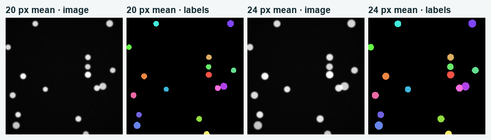

# Fovea SynthData

Fovea Lab builds synthetic microscopy datasets for testing image-analysis pipelines. Give SynthData a plate design and a seed, and it writes the images an analysis pipeline would receive, the instance masks that identify each object, and the ground-truth measurements you can score against.



**Can your pipeline recover a four-pixel change?** These are the same 16 particles in well C01, site 1, with the same seed and display contrast. Increasing `conditions.large.diameter.mean` from **20 to 24 pixels** shifts the median diameter recorded in ground truth across that condition from **19.57 to 23.57 pixels**. The reference pipeline measures each particle it segments, then takes the median of the four well medians. It reports **20.00 and 23.82 pixels** for the two designs. [Explore the particle plate](https://github.com/Fovea-Lab/fovea-synthdata/blob/main/docs/generators/particle-plate.md)

## Run a known-answer test

From a clone of this repository, create a Python 3.12+ environment and install the particle generator. The distribution is named `fovea-synthdata`. The command and Python import are both `synthdata`.

```sh
python -m venv .venv
source .venv/bin/activate
python -m pip install '.[particle_plate]'

synthdata preset export particle_plate/small -o particles.yaml
synthdata generate particles.yaml -o out/particles --writer tiff
synthdata check out/particles
```

For a published PyPI release, use `python -m pip install 'fovea-synthdata[particle_plate]'` in place of the local checkout install.

With the bundled seed of **7**, the result is **32 wells, 64 images and 1,123 particles**. Open `out/particles/check/report.md` to see what the reference pipeline recovered. Its median well-level diameter was 13.06 pixels in the control and 20.00 pixels in the large-particle condition.

To test your own pipeline, pass it the TIFFs under `images/` and the well assignments in `platemap.csv`. Score its output against `masks/` and `truth/particles.parquet` afterward. Each dataset also includes the resolved design and a manifest with the seed, generator version and file hashes.

## Choose a generator

| Generator | What it tests | Data written |
| --- | --- | --- |
| [Particle plate](https://github.com/Fovea-Lab/fovea-synthdata/blob/main/docs/generators/particle-plate.md) | Counting, segmentation, size, orientation, clustering and aggregation QC in one channel | TIFF or OME-Zarr images, instance masks and particle, image, well and QC tables |
| [Cell Painting plate](https://github.com/Fovea-Lab/fovea-synthdata/blob/main/docs/generators/cell-plate.md) | Multi-channel ingestion, nucleus-to-cell assignment, feature recovery and QC across compounds, doses and controls | Channel TIFFs, stacked TIFFs or OME-Zarr, paired cell and nucleus masks, acquisition metadata and truth tables |

In the Cell Painting example, one field contains 16 cell bodies and 27 nuclei. The two mask panels color each nucleus by its parent cell, exposing what a one-nucleus-per-cell assumption would miss. [View the channels and masks](https://github.com/Fovea-Lab/fovea-synthdata/blob/main/docs/generators/cell-plate.md)

## Change the experiment

The exported YAML is yours to edit. In `particles.yaml`, change the mean under `conditions.large.diameter` from `20` to `24` to plant a larger difference while keeping the seed and all other conditions fixed. Preview it, then generate into a fresh directory to keep the first run for comparison.

```sh
synthdata preview particles.yaml -o larger-particles.png
synthdata generate particles.yaml -o out/larger-particles --writer tiff
synthdata check out/larger-particles
```

Use `synthdata list` to discover generators and `synthdata preset list` to discover designs. In a notebook, `sdk.load_preset()` returns the same editable design as a Python dictionary.

```python
from synthdata import sdk

design = sdk.load_preset("particle_plate/small")
design["conditions"]["large"]["diameter"]["mean"] = 24
manifest = sdk.generate(design, "out/python-particles", writer="tiff")
print(manifest.seed, manifest.extra["n_wells"])
```

Use `synthdata-api` to serve the local HTTP API or connect an MCP client to `synthdata-mcp` over stdio. Both share the SDK's generator catalog. The optional `report` extra adds offline HTML reports for particle plates, and the `app` extra adds the local particle-plate editor. [Interface reference and installation options](https://github.com/Fovea-Lab/fovea-synthdata/blob/main/docs/interfaces.md)

## Contribute

Have a pipeline failure that needs a reproducible fixture? Open an issue with the expected measurement, the smallest design that exhibits it and the observed result. The contribution guide explains how to propose a generator, register it, and supply a known-answer test. [Contributor guide](https://github.com/Fovea-Lab/fovea-synthdata/blob/main/CONTRIBUTING.md)

Fovea SynthData is released under the [Apache License 2.0](https://github.com/Fovea-Lab/fovea-synthdata/blob/main/LICENSE).
