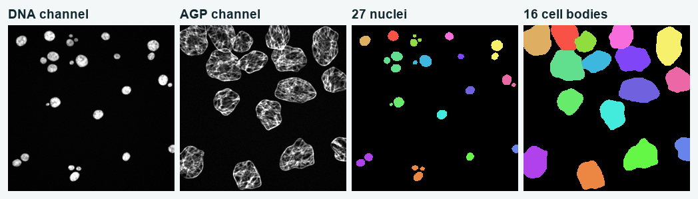

> **AI authorship:** Created by OpenAI Codex. **Model:** the exact runtime model identifier was not exposed to the assistant.

# Cell Painting plate

Use `cell_plate` to exercise channel loading, cell and nucleus segmentation, per-well profiling and imaging QC on a plate with known answers. Each synthetic compound and dose changes selected rendering parameters. Compound identifiers, phenotype names and mechanism groups serve as labels for testing software.



Plate 01, well A04, site 1 from `cell_plate/small` contains **16 cells and 27 nuclei**. Eight cells have multiple nuclei. The two grayscale panels are 384 × 384 pixel TIFFs scaled independently for display. In the label panels, each nucleus takes the color of its parent cell using the ground-truth association. The source files preserve an integer ID for each nucleus and each cell.

## Generate and inspect

From the repository root, install the generator into your active Python 3.12+ environment.

```sh
python -m pip install '.[cell_plate]'
synthdata preset export cell_plate/small -o cell-small.yaml
synthdata generate cell-small.yaml -o out/cell-small --writer tiff
synthdata check out/cell-small
```

The shipped seed of **2026** produces 96 sites and 192 channel TIFFs. The placement algorithm fits 1,315 of 1,321 requested cells. It records the six unplaced cells in the manifest. The truth tables contain 1,392 nuclei. All eight blank wells have empty masks.

To look up the parent of every nucleus in the illustrated field, filter to its plate, well and site before joining on object ID.

```python
import pandas as pd

nuclei = pd.read_parquet("out/cell-small/truth/nuclei.parquet")
field = nuclei.query("plate == 'plate01' and well == 'A04' and site == 1")
counts = field.groupby("cell_id")["nucleus_id"].count()
print(len(counts), counts.sum(), (counts > 1).sum())  # 16 27 8
```

The reference segmenter recovered a median count of 18.5 cells per site across the negative-control wells, compared with 6 in the high-dose `CPD-002` wells. It measured a median cell area of 3,021 px² in controls and 5,150 px² in high-dose `CPD-004` wells. The full check documents the well counts, excluded sites and thresholds next to each result.

## Choose a design

| Preset | Plate and channels | Intended use |
| --- | --- | --- |
| `small` | 96 wells, one 384 × 384 field per well, DNA and AGP | A quick end-to-end test of ingestion, segmentation and QC. |
| `default` | 96 wells, two 1024 × 1024 fields per well, DNA, ER, RNA, AGP and Mito | Evaluate a five-channel pipeline on a separate evaluation design. |
| `tuning` | Same five-channel plate layout, one site per well, seed 4242 | Select segmentation or profiling parameters before running `default`. |
| `moa_small` | Two 96-well plates, one 512 × 512 field per well, five channels | Test wiring for multi-plate grouping, TIFF stacks and mechanism labels. |
| `moa_tuning`, `moa` | Two 96-well plates, two 1024 × 1024 fields per well, five channels | Tune and evaluate profiles across 18 synthetic test compounds and two doses with planted plate effects. |

In the small design, `base_cell.count` is Poisson with mean 18 before well, compound and placement effects. The design uses 0.65 µm pixels and uint16 intensities. Edit `base_cell` to change baseline cell shape or channel intensities. Edit `phenotypes`, `compounds` and `doses` to plant a specific comparison. The `layout` fixes control positions and distributes replicate treatments among the remaining wells. `qc_defects` assigns six blurred sites and four sites with saturated debris in this preset.

## Read the outputs

| Writer | Measurement inputs | Instance labels |
| --- | --- | --- |
| `tiff` | One TIFF per site and channel | Separate `*_cells.tif` and `*_nuclei.tif` files under `truth/labels/` |
| `tiff_stack` | One TIFF per site with axes `CYX` in design channel order. Each channel row in `images.csv` refers to the same stack. | Same layout as `tiff` |
| `ome_zarr` (default) | One OME-Zarr HCS store per plate | Per-field `labels/cells` and `labels/nuclei` arrays |

Load `images.csv`, `acquisition.json` and `platemap.csv` for image paths, channel order, geometry, well assignments and concentrations. For the multi-plate presets, the plate map also includes the planted `moa` class. Reserve that column for evaluation when testing unsupervised retrieval.

Use `truth/cells.parquet` and `truth/nuclei.parquet` to score instance counts, geometry and nucleus-to-cell assignments. The image, well and QC tables describe channel-level acquisition effects, planted phenotypes and damaged sites. The resolved `design.yaml` and `manifest.json` record how to reproduce the dataset.

## Interpret the check

The checker compares written labels and counts against truth, then runs a reference segmenter on the images. Its counts and areas can serve as a baseline for another pipeline. It excludes saturated-debris sites from the relevant comparisons and reports four feature expectations in the small design as `not_checked` because its segmenter has no corresponding texture, granularity or neighbor measurements. An overall pass covers the checks it actually ran.

The multi-plate presets inject gain and count shifts between plates. The built-in comparison pools those plates, so it can flag planted differences. Evaluate batch correction and group retrieval separately using the plate and compound identifiers.
