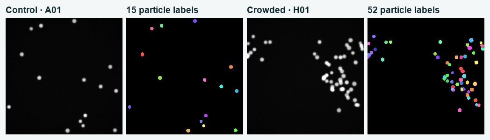

> **AI authorship:** Created by OpenAI Codex. **Model:** the exact runtime model identifier was not exposed to the assistant.

# Particle plate

Use `particle_plate` to test whether an image pipeline counts individual objects, recovers their size and orientation, and distinguishes a planted change from variation between replicate wells. Each particle is an ellipse with a sampled position, shape and intensity. Generation records these values before the pipeline sees the image.



These are complete fields from `particle_plate/small`, seed 7, plate 01, site 1. Control well A01 contains 15 particles. Crowded well H01 contains 52, several of which touch. Both images use the same display contrast. Each nonzero value in a source mask identifies a particle within that field.

## Generate and inspect

Install the `particle_plate` extra from the repository root. These commands export the editable design, render a TIFF dataset and check the result.

```sh
python -m pip install '.[particle_plate]'
synthdata preset export particle_plate/small -o particle-small.yaml
synthdata generate particle-small.yaml -o out/particle-small --writer tiff
synthdata check out/particle-small
```

For this run, the table below compares two ways of measuring diameter. The truth column takes the median over all particle diameters sampled for that condition. The image column comes from the reference pipeline, which thresholds the images, measures segmented objects, and takes the median of the four well medians.

| Condition | Sampled diameter, px | Diameter estimated from images, px |
| --- | ---: | ---: |
| Control | 11.87 | 13.06 |
| Large | 19.57 | 20.00 |

The full run wrote 1,123 particles across 64 images. Of those, 843 were eligible for the mask-fidelity check after excluding clipped or touching particles. All 843 matched a mask label. Median absolute diameter error on those masks was 0.057 pixels. See `check/report.md` for the tolerances and `check/report.json` for the machine-readable results.

## Set up a test

| Preset | Plate and image size | What it exercises |
| --- | --- | --- |
| `small` | 32 wells × 2 sites, 384 × 384 px, seed 7 | Eight conditions in four replicate wells each. Suitable for the first run or a fast regression test. |
| `default` | 96 wells × 4 sites, 1024 × 1024 px, seed 42 | The same eight conditions with twelve replicates each. Use this for a more stable comparison between conditions. |
| `small_qc`, `default_qc` | QC variants of the respective plate sizes | Plant particle aggregation and compare a QC detector's calls against the recorded degree and label. |

The presets use one uint16 channel at 0.65 µm per pixel. Edit `base_particle` to change the count, diameter, eccentricity, orientation, signal or edge softness inherited by every condition. Use `conditions` to override a property for a selected group. For example, the `aligned` group samples orientations around 45° with a 5° standard deviation. Ellipse orientation is measured from the image's positive x-axis toward increasing row number, modulo 180°.

`image_effects` controls background, Poisson and Gaussian noise, illumination and edge-well dimming. `layout` supports row, column, explicit and randomized assignments. The array of wells, pixel dimensions, sites per well and seed can all be changed in the exported YAML. `synthdata preview DESIGN.yaml -o preview.png` renders examples before a full run.

## Read the outputs

| Output | Use |
| --- | --- |
| `images/*.tif`, `platemap.csv` | Supply images and well assignments to the measurement pipeline. |
| `masks/*_mask.tif` | Compare segmentation against the uint32 instance mask. Zero is background. |
| `truth/particles.parquet` | Match a mask label to `particle_id` using `plate`, `well` and `site`. Inspect position, sampled shape, signal, clipping, touching and visible area. |
| `truth/images.parquet`, `truth/wells.parquet`, `truth/qc.parquet` | Score counts by field, condition summaries and planted QC defects. |
| `design.yaml`, `manifest.json` | Reconstruct the run from the resolved design, seed, versions, writer and checksums. |

Omit `--writer tiff` to use the default `ome_zarr` writer. It emits one OME-Zarr HCS store per plate with an image pyramid and a `labels/particles` array for each field. The Parquet tables accompany both formats.

## Interpret the check

The hard mask represents the ellipse boundary. Soft edges, overlap, finite pixel size and background noise can shift measurements taken from intensities. The reference check measures mask fidelity separately from recovery of the planted effects in the images. A fresh random seed can change a statistical check, especially with the four replicate wells in `small`. To review distributions, effect sizes and clustering across wells, install the `report` extra and run `synthdata report out/particle-small` to produce an offline HTML report.
